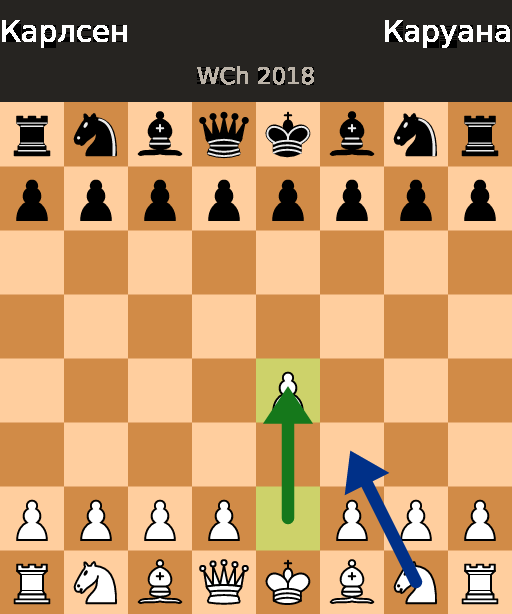
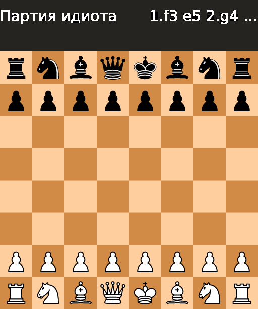
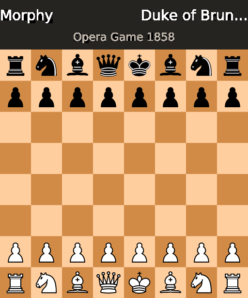

# boardimage

English | **[Русский](README.ru.md)**

[](https://github.com/Draughts64/boardimage/actions/workflows/ci.yml)
[](https://github.com/Draughts64/boardimage/releases)
[](LICENSE)

A board rendering service: **draughts** (18 PDN variants —
international, russian, italian, canadian, turkish…) and **chess**.
Position images as **PNG / WebP / SVG** and animated **GIF** replays.
Rust, stateless, two-tier cache, Prometheus metrics, OpenAPI/Swagger.
Runs as a web service and as a CLI.

Full specification (Russian): **[SPEC.md](SPEC.md)**.

## Demos

Everything is generated by the CLI from [`demo/`](demo/) —
**[online gallery](https://draughts64.github.io/boardimage/)**,
chess showcase on a separate page:
**[/chess.html](https://draughts64.github.io/boardimage/chess.html)**.

| | | |
|---|---|---|
|  |  |  |
| **chess**: UCI arrows, lastMove, captions | **draughts**: engine arrows + heatmap | russian: 1..32 numbers + border + theme |
|  |  |  |
| italian: light squares + cyrillic | custom theme (SVG sprites) | turkish: all 64 squares |
|  |  |  |
| canadian 12×12 + arrows | black orientation + border | PNG 16.8K / WebP 7.3K / SVG 5K |

Animated GIF replays with caption bars (cyrillic via the embedded
DejaVu Sans font; the comment is also written into GIF metadata):

<p>



</p>

## Chess

`--game chess` (server: `?game=chess`) switches the service to chess:

- regular **chess FEN** per the [PGN Standard §16.1.3](http://www.saremba.de/chessgml/standards/pgn/pgn-complete.htm)
  (`rnbqkbnr/pppppppp/8/8/8/8/PPPPPPPP/RNBQKBNR w KQkq - 0 1`);
  halfmove counters may be omitted (EPD), Shredder-FEN castling files
  (`AHah`) are accepted, en-passant is validated by the spec;
- the **cburnett** piece set is built in (rasterised to the cell size,
  cached; licence attribution in `assets/pieces/cburnett/`);
- UCI arrows and lastMove (`Ge2e4`, `e2e4`), heatmap highlighting,
  board themes, the a..h/1..8 border, coords — everything from the
  draughts mode;
- GIF replays: `--game chess` + one `--fen` per position.

```bash
boardimage render --game chess --arrows "Ge2e4,Bg1f3" --last-move e2e4 \
  --white "Carlsen" --black "Caruana" --comment "WCh 2018" \
  --fen "rnbqkbnr/pppppppp/8/8/4P3/8/PPPP1PPP/RNBQKBNR b KQkq e3 0 1" \
  --out m.png
```

## Quick start

```bash
cargo run                    # web: http://127.0.0.1:8080/healthz
cargo run -- render ...      # CLI, no server
docker build -t boardimage . # production image (~15 MB)
docker run -p 8080:8080 ghcr.io/draughts64/boardimage   # prebuilt from GHCR
```

## Docker

Prebuilt images are published to GHCR on every push: `latest` (master)
and version tags (`v0.1.0`, …).

```bash
docker pull ghcr.io/draughts64/boardimage:latest
docker run -d --name boardimage -p 8080:8080 \
  -e CACHE_MB=256 \
  -v boardimage_cache:/cache -e CACHE_DIR=/cache -e CACHE_MB_DISK=2048 \
  -v ./my-themes:/themes:ro \
  ghcr.io/draughts64/boardimage:latest
curl http://127.0.0.1:8080/healthz   # ok
```

The image ships example themes (`/themes/neon`); mount your own over it.
All variables: `BIND` (0.0.0.0:8080), `CACHE_MB` (in-memory LRU),
`CACHE_DIR` + `CACHE_MB_DISK` (disk cache with size-based eviction),
`THEMES_DIR` (themes directory, default `/themes`).

> While the GHCR package is private, `docker pull` requires
> `docker login ghcr.io` (a PAT with `read:packages`). Once the package
> visibility is switched to public it works without login.

## CLI: `boardimage render`

The output format follows the `--out` extension: `.png` / `.svg` /
`.webp` / `.gif` (PNG by default). Unknown flags are a hard error that
lists the allowed ones.

```bash
# draughts, international start: numeric squares, ranges, engine :H0:F1 ok
boardimage render --fen "W:W31-50:B1-20:H0:F1" --out start.png --size 512

# draughts, algebraic squares (a1..k10), 8x8 english board
boardimage render --game-type 21 --fen "W:Wa3,g3,b2:Bb8,Kc3" --out pos.png

# draughts, full PDN GameType tag; default notation comes from the tag
boardimage render --game-type "21,B,8,8,N1,0" --fen "B:W18,K10:B12,K22" --out e.svg

# draughts: per-square numbers + algebraic border + cyrillic caption
boardimage render --variant russian --notation numeric --margin 24 \
  --white "Sidorova A." --black "Kuznetsov D." --last-move 2521 \
  --fen "W:W21-32:B1-12" --out r.png

# draughts, analysis board: engine arrows + heatmap + lastMove
boardimage render --arrows "4741,3228" --squares "23:0.7" --last-move 4741 \
  --comment "Engine: 47-41 (+1.2)" --fen "W:W36,K47:B5,23" --out a.png

# GIF replay (draughts or chess): repeat --fen per frame
boardimage render --variant russian --delay-ms 800 \
  --white "Sidorova" --black "Kuznetsov" --comment "Blitz" \
  --fen "W:W21-32:B1-12" --fen "W:W21-30,25,32:B1-12" \
  --fen "W:W21-30,25,32:B1-10,12,18" --out game.gif
```

| Flag | Meaning | Default |
|---|---|---|
| `--game chess` | chess mode (chess FEN + cburnett pieces) | draughts |
| `--fen <FEN>` | position; repeat for GIF frames | required |
| `--out <file>` | `.png` / `.svg` / `.webp` / `.gif` by extension | required |
| `--size <16..1024>` | image side (GIF ≤640) | 512 |
| `--game-type <t>` | PDN number (20–41, 96–98) or full tag `21,B,8,8,N1,0` | 20 |
| `--variant <name>` | standard, russian, italian, turkish, … | standard |
| `--board-size` / `--board-height` | custom board (even 2..16) | 10×10 |
| `--numbering <0..3>` | where square 1 starts: 0 bottom-left … 2 top-left (engine canon) | per variant |
| `--light-squares` | playing squares are light | per variant |
| `--theme <name>` | built-in or from `THEMES_DIR` | lidraughts-brown |
| `--light` / `--dark` | inline board colours `#rrggbb` | per theme |
| `--notation` | none / numeric / algebraic / coords | none |
| `--margin <px>` | margin band around the board | 0 |
| `--border` / `--no-border` | algebraic border (combines with numeric) | on when margin>0 |
| `--last-move <m>` | `3228`, `32-28`, `c3-b4`, `e2e4` — highlight | — |
| `--arrows <csv>` | `G3228,R0622,44` / `Ge2e4` — arrows + circle | — |
| `--squares <csv>` | `46:0.9,12` — cell highlighting with intensity | — |
| `--white` / `--black` | player names (Unicode) — caption bar | — |
| `--comment <text>` | caption note; also GIF metadata | — |
| `--delay-ms <100..3000>` | GIF frame delay | 700 |
| `--quality <1..100>` | WebP; 100 = lossless | 85 |
| `--flip` / `--flat` / `--transparent` | black orientation / flat style / transparent bg | — |

## Web API (short — full in SPEC.md and /swagger)

```
# draughts
GET /board.png?fen=W:W31-50:B1-20&boardSize=10&size=1024
GET /board.png?fen=W:Wa1,c1:Bb8&gameType=21        # algebraic FEN
GET /board.png?fen=...&gameType=22                 # italian (light squares)
GET /board.png?fen=...&notation=numeric            # 1..50 on every square
# chess
GET /board.png?game=chess&fen=rnbqkbnr/pppppppp/8/8/8/8/PPPPPPPP/RNBQKBNR%20w%20KQkq%20-%200%201
GET /board.webp?game=chess&fen=...&quality=85      # 100 = lossless
GET /board.svg?fen=...&arrows=G0622,44             # analysis-style arrows
POST /game.gif   { "game": "chess", "frames": [ {"fen": "...", "lastMove": "e2e4"} ] }
```

`GET /openapi.json` — machine spec; `/swagger` and `/redoc` — docs;
`/metrics` — Prometheus; `/healthz` — liveness.

No rules engine inside: the client plays the game (the
[Draughts64/draughts](https://github.com/Draughts64/draughts) monolith
for draughts — the lila-gif architecture) and posts ready frames.

## FEN

**Draughts** — full PDN 3.0 ([wiegerw.github.io/pdn/fen.html](https://wiegerw.github.io/pdn/fen.html)):
side to move `W`/`B`/`?`, both piece lists (possibly empty), prefixes
`K` (king), `G`/`P` (ghosts — UPPERCASE only; lowercase k/g are file
letters), ranges `31-50`, engine suffixes `:H0:F1` skipped. Squares are
numeric (lidraughts engine / FMJD canon: square 1 top-left, white at
the bottom) **or algebraic** (`a1`, `Kc3`); on 10-wide boards the
letter `j` is skipped (`a…i,k`).

**Chess** — the regular FEN (see the Chess section above): six fields,
counters optional, en-passant rank 3/6 only.

The draughts board variant comes from `gameType` (number 20–41, 96–98 —
or the full tag `"21,B,8,8,N1,0"`), a `variant` alias, or the
`boardSize`/`boardHeight` pair (+ `lightSquares`, `allSquares`,
`numbering`).

## Custom themes (the chess way)

Two ways to define a design:

```bash
# 1) inline — board colours only
boardimage render --light "#f0d9b5" --dark "#b58863" --fen ... --out b.png
curl "http://127.0.0.1:9091/board.png?fen=...&light=%23f0d9b5&dark=%23b58863"

# 2) a THEMES_DIR catalogue — colours + piece sprites (SVG or PNG):
#    themes/neon/theme.json:
#    {"light":"#2b2b3b","dark":"#3d3d54",
#     "pieces":{"wm":"wm.svg","bm":"bm.svg","wk":"wk.svg","bk":"bk.svg"}}
THEMES_DIR=./themes boardimage render --theme neon --fen ... --out n.png
```

Sprites: `wm`/`bm` required, `wk`/`bk` optional (fallback: the man
sprite + a vector crown); SVG is rasterised to the cell size and cached;
ghost pieces render at 0.3 opacity; SVG output embeds sprites as
data-URIs. In chess mode themes recolour the board while the cburnett
pieces stay (custom chess sets are future work). Full example:
[`themes/neon/`](themes/neon).

## Status and v1 limitations

Draughts: all 18 PDN GameType variants (italian light squares, canadian
12×12, turkish all-squares, spanciretti 10×8), engine-canonical
numbering. Chess: full FEN + cburnett. Shared: analysis-style
arrows/circles/brushes (a draughtsground port), Unicode captions,
two-tier cache + ETag, 53 tests. Documented simplifications: PNG is
full-colour RGBA (no palette quantisation yet), no formal load test.

## License

AGPL-3.0. API contract from
[niklasf/web-boardimage](https://github.com/niklasf/web-boardimage),
GIF techniques from [lichess-org/lila-gif](https://github.com/lichess-org/lila-gif),
caption font: DejaVu Sans (licence in `assets/`),
chess pieces: cburnett, GPL-2.0-or-later (`assets/pieces/cburnett/`).
