# boardimage

**[English](README.md)** | Русский

[](https://github.com/Draughts64/boardimage/actions/workflows/ci.yml)
[](https://github.com/Draughts64/boardimage/releases)
[](LICENSE)

Сервис рендера шашечных досок: **PNG / WebP / SVG** картинки позиций и
**GIF-реплеи** партий. Rust, ноль состояния, двухуровневый кэш, метрики
Prometheus, OpenAPI/Swagger. Работает и как web-сервис, и как CLI.

Полное техническое задание: **[SPEC.md](SPEC.md)**.

## Демо

Все примеры генерируются CLI из каталога [`demo/`](demo/) — открой
[`demo/index.html`](demo/index.html) для галереи со всеми 45+ файлами.

| | | |
|---|---|---|
| 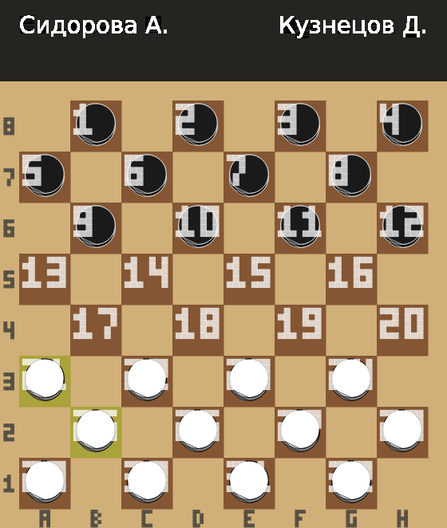 | 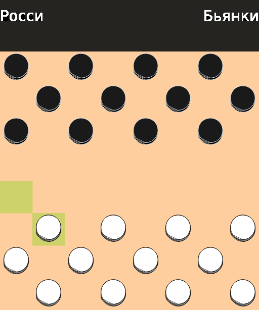 | 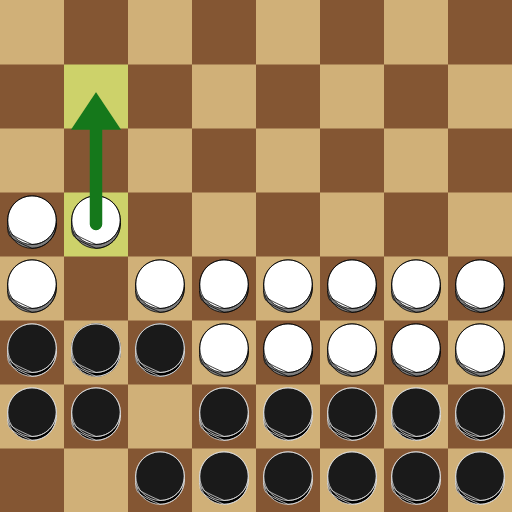 |
| русские: номера 1..32 + рамка + тема | итальянские: светлые клетки + кириллица | турецкие: все клетки + спанциретти-дерево |
| 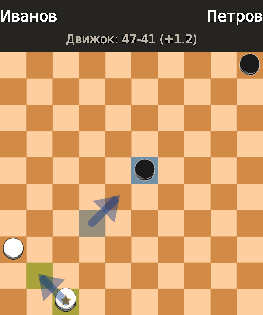 | 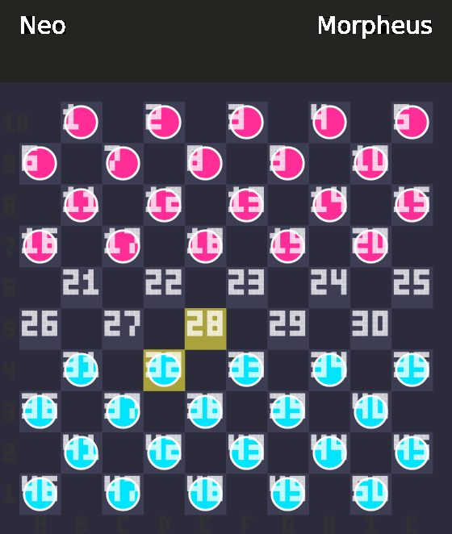 | 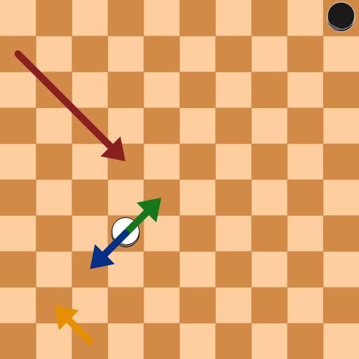 |
| анализ-борд: движковые стрелки + heatmap | кастомная тема (SVG-спрайты) | стрелки G/B/R/Y + круг |
| 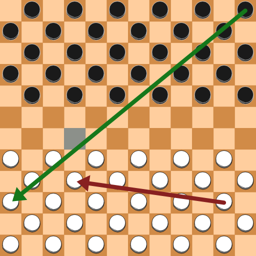 | 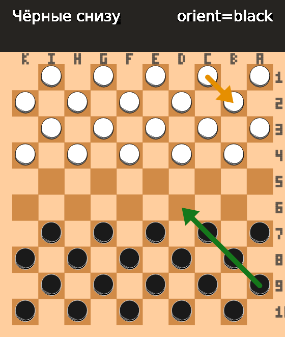 | 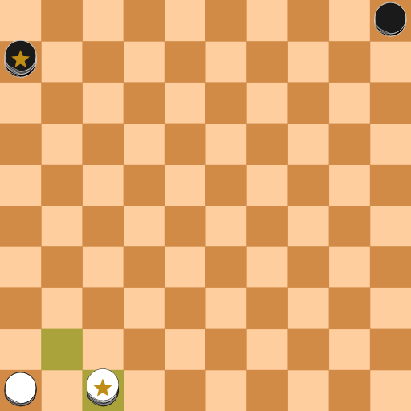 |
| канадские 12×12 + стрелки | ориентация чёрными + рамка | PNG 16.8К / WebP 7.3К / SVG 5К |

Анимация — GIF-реплеи с полосой подписей (кириллица встроенным шрифтом
DejaVu Sans, комментарий пишется в метаданные файла):

<p>
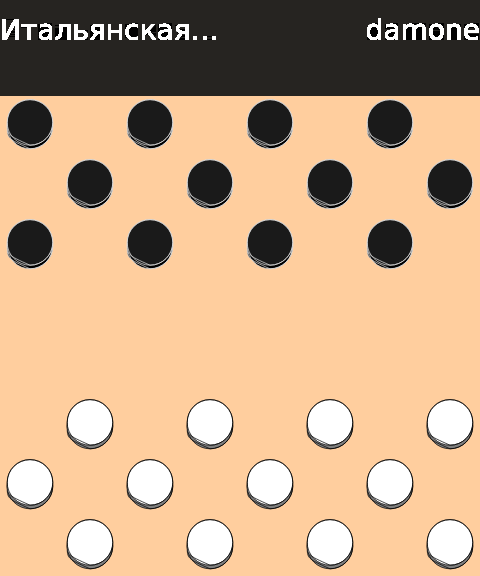
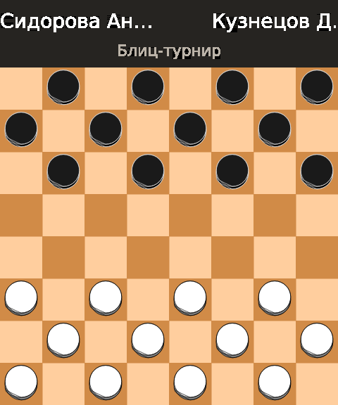
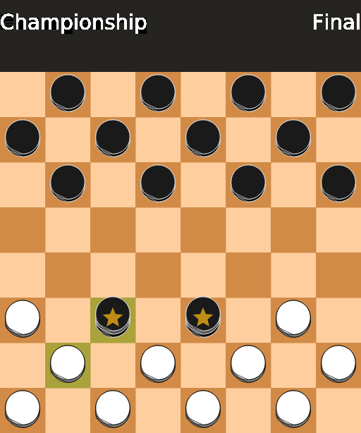
</p>

## Быстро

```bash
cargo run                    # web: http://127.0.0.1:8080/healthz
cargo run -- render ...      # CLI без сервера
docker build -t boardimage . # прод-образ (~15 МБ)
```

Окружение web-сервера: `BIND` (0.0.0.0:8080), `CACHE_MB` (LRU в памяти),
`CACHE_DIR` + `CACHE_MB_DISK` (дисковый кэш с вытеснением), `THEMES_DIR`
(каталог кастомных тем).

## CLI: `boardimage render`

Формат выбирается расширением `--out`: `.png` / `.svg` / `.webp` / `.gif`
(по умолчанию PNG). Неизвестный флаг — ошибка со списком разрешённых.

```bash
# старт 10×10: числовые клетки, диапазоны, движковые :H0:F1 ок
boardimage render --fen "W:W31-50:B1-20:H0:F1" --out start.png --size 512

# алгебраические клетки (a1..k10) — FEN из любого генератора; доска 8×8 english
boardimage render --game-type 21 --fen \
  "W:Wa3,g3,b2:Bb8,Kc3" --out pos.png

# полный PDN GameType-тег; нотация по умолчанию возьмётся из тега
boardimage render --game-type "21,B,8,8,N1,0" --fen "B:W18,K10:B12,K22" --out e.svg

# русские: номера на клетках + алгебраическая рамка + кириллица
boardimage render --variant russian --notation numeric --margin 24 \
  --white "Сидорова А." --black "Кузнецов Д." --last-move 2521 \
  --fen "W:W21-32:B1-12" --out r.png

# анализ-борд: стрелки движка + heatmap + lastMove
boardimage render --arrows "4741,3228" --squares "23:0.7" --last-move 4741 \
  --comment "Движок: 47-41 (+1.2)" --fen "W:W36,K47:B5,23" --out a.png

# GIF-реплей: --fen повторяется по кадрам
boardimage render --variant russian --delay-ms 800 \
  --white "Сидорова Анна" --black "Кузнецов Д." --comment "Блиц" \
  --fen "W:W21-32:B1-12" --fen "W:W21-30,25,32:B1-12" \
  --fen "W:W21-30,25,32:B1-10,12,18" --out game.gif
```

| Флаг | Значение | По умолчанию |
|---|---|---|
| `--fen <FEN>` | позиция; повторяйте для GIF-кадров | обязателен |
| `--out <file>` | `.png` / `.svg` / `.webp` / `.gif` по расширению | обязателен |
| `--size <16..1024>` | сторона картинки (GIF ≤640) | 512 |
| `--game-type <t>` | число PDN (20–41, 96–98) или полный тег `21,B,8,8,N1,0` | 20 |
| `--variant <name>` | standard, russian, italian, turkish, … | standard |
| `--board-size` / `--board-height` | своя доска (чётные 2..16) | 10×10 |
| `--numbering <0..3>` | начало клетки 1: 0 низ-слева … 2 верх-слева (канон) | по варианту |
| `--light-squares` | рабочие клетки светлые | по варианту |
| `--theme <name>` | встроенная или из `THEMES_DIR` | lidraughts-brown |
| `--light` / `--dark` | инлайн-цвета доски `#rrggbb` | по теме |
| `--notation` | none / numeric / algebraic / coords | none |
| `--margin <px>` | поля вокруг доски | 0 |
| `--border` / `--no-border` | алгебраическая рамка (сочетается с numeric) | вкл при margin>0 |
| `--last-move <m>` | `3228`, `32-28`, `c3-b4` — подсветка последнего хода | — |
| `--arrows <csv>` | `G3228,R0622,44` — стрелки G/B/R/Y + круг | — |
| `--squares <csv>` | `46:0.9,12` — подсветка клеток с интенсивностью | — |
| `--white` / `--black` | имена (Unicode/кириллица) — полоса подписи | — |
| `--comment <текст>` | подпись; в GIF пишется в метаданные файла | — |
| `--delay-ms <100..3000>` | задержка GIF-кадров | 700 |
| `--quality <1..100>` | WebP; 100 = lossless | 85 |
| `--flip` / `--flat` / `--transparent` | ориентация чёрными / плоский стиль / прозрачный фон | — |

## Web API (кратко — полностью в SPEC.md и /swagger)

```
GET /board.png?fen=W:W31-50:B1-20&boardSize=10&size=1024
GET /board.webp?fen=...&quality=85            # 100 = lossless
GET /board.svg?fen=...&arrows=G0622,44
GET /board.png?fen=W:Wa1,c1:Bb8&gameType=21   # алгебраический FEN
GET /board.png?fen=...&gameType=22            # итальянские (светлые клетки)
GET /board.png?fen=...&notation=numeric       # номера 1..50 у каждой клетки
POST /game.gif   { "frames": [ {"fen": "...", "lastMove": "4741"} ] }
```

`GET /openapi.json` — машина; `/swagger` и `/redoc` — документация;
`/metrics` — Prometheus; `/healthz` — живость.

Шашечного движка в сервисе нет: партию проигрывает монолит
[Draughts64/draughts](https://github.com/Draughts64/draughts) и
присылает готовые кадры (архитектура lila-gif).

## FEN

Принимается полный PDN 3.0 ([wiegerw.github.io/pdn/fen.html](https://wiegerw.github.io/pdn/fen.html)):
ход `W`/`B`/`?`, списки клеток обеих сторон (можно пустые), префиксы
`K` (король), `G`/`P` (призрачные; префиксы — только ЗАГЛАВНЫЕ, строчные
k/g — это файлы алгебраических имён), диапазоны `31-50`, движковые
суффиксы `:H0:F1` пропускаются. Клетки задаются числами (канон
движка/FMJD: клетка 1 сверху-слева, белые снизу) **или алгебраически**
(`a1`, `Kc3`) — имена физические, ранг 1 снизу; на досках шириной 10
буква `j` пропускается (`a…i,k`, chess-style `j` принимается как
псевдоним `k`).

Вариант доски задаётся `gameType` (число 20–41, 96–98 — или полный тег
`"21,B,8,8,N1,0"`), `variant`-алиасом или парой `boardSize`/`boardHeight`
(+ `lightSquares`, `allSquares`, `numbering`).

## Кастомные темы (как у шахмат)

Два способа задать свой дизайн:

```bash
# 1) инлайн — только цвета доски
boardimage render --light "#f0d9b5" --dark "#b58863" --fen ... --out b.png
curl "http://127.0.0.1:9091/board.png?fen=...&light=%23f0d9b5&dark=%23b58863"

# 2) каталог тем THEMES_DIR — цвета + спрайты шашек (SVG или PNG):
#    themes/neon/theme.json:
#    {"light":"#2b2b3b","dark":"#3d3d54",
#     "pieces":{"wm":"wm.svg","bm":"bm.svg","wk":"wk.svg","bk":"bk.svg"}}
THEMES_DIR=./themes boardimage render --theme neon --fen ... --out n.png
```

Спрайты: `wm`/`bm` обязательны, `wk`/`bk` опциональны (упав — простая
шашка + векторная корона); SVG растеризуется под размер клетки и
кэшируется; призрачные шашки — opacity 0.3; в SVG-выводе спрайт
встраивается как data-URI. Пример целиком: [`themes/neon/`](themes/neon).

## Статус и ограничения v1

Полный рендер 18 вариантов по PDN GameType (итальянские светлые клетки,
канадские 12×12, турецкие все клетки, спанциретти 10×8), нумерация-канон
движка lidraughts, стрелки/кольца/кисти как на analysis, Unicode-подписи
встроенным шрифтом, 46 автотестов. Задокументированные упрощения: PNG
полноцветный RGBA (palette-квантование не делается), формальный
нагрузочный тест не прогонялся.

## Лицензия

AGPL-3.0. API-контракт — из
[niklasf/web-boardimage](https://github.com/niklasf/web-boardimage),
приёмы GIF — из [lichess-org/lila-gif](https://github.com/lichess-org/lila-gif),
шрифт подписей — DejaVu Sans (лицензия в `assets/`).
